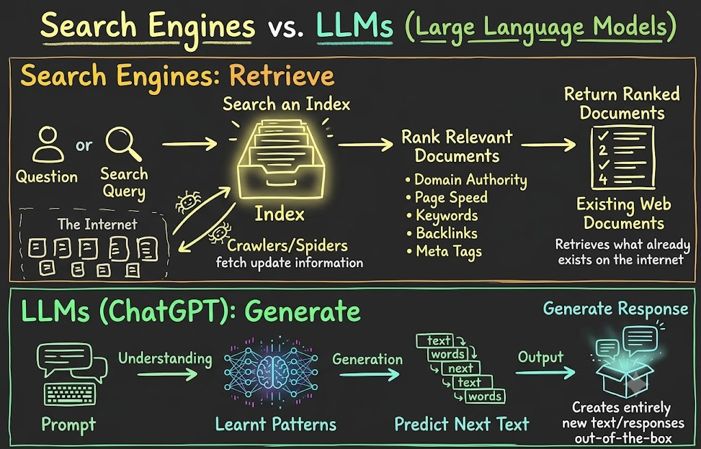
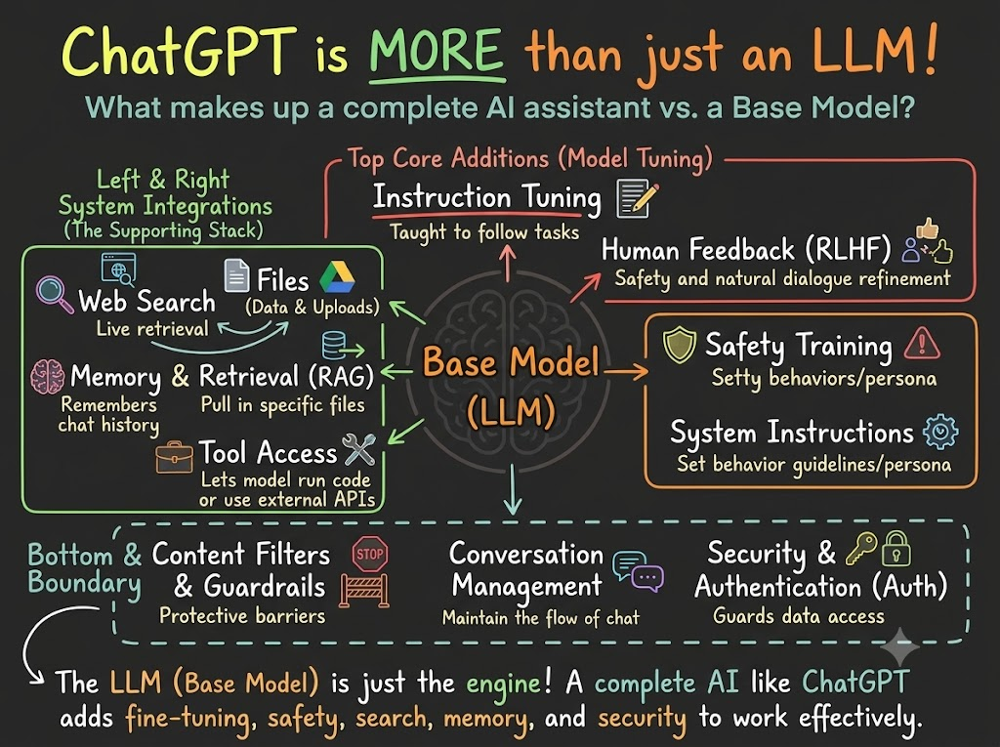
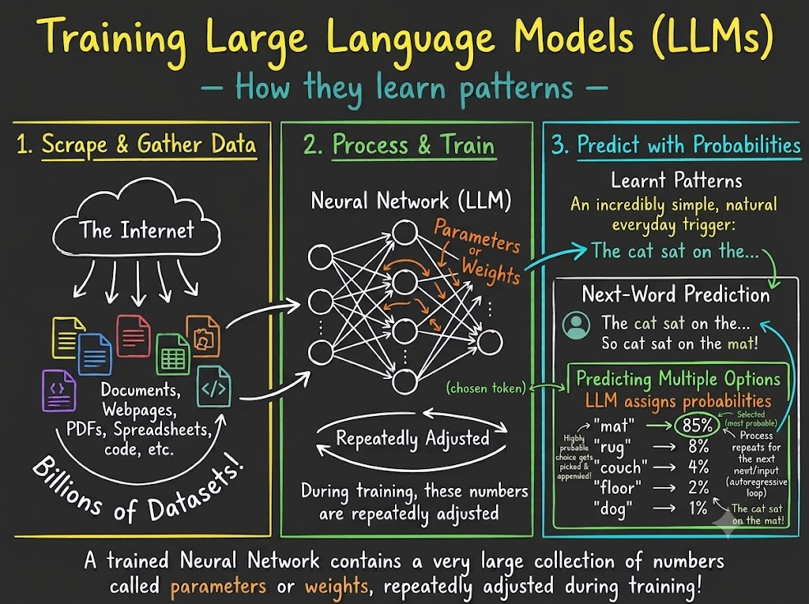

# Does ChatGPT know or does it guess ? Is it just a better search engine?

Just try to search in Google and ask to ChatGPT the following:

1. **Who is Dr. APJ Abdul Kalam?** = GPT will give direct annswers, while Google will provide links to various sources. You will immedietly feel GPT is a better search engine.
2. **Why NamasteAI red wine in Himalayan regions is so expensive ?** = Google will not provide anything, as this doesn't exist, while GPT will try to give you some incredible resources, and random answers. Why is it happening ? Wasn't this a better search engine ?

### Search Engines vs LLMs

- **Google**: Question -> Search and index -> Rank relevant sources -> Return results according to appropriate algorithm
- **LLMs (like ChatGPT)**: Prompt -> Learn patterns from data -> Predict next text -> Generate response

> [!TIP]
> 
>
> - Search engines = Retrieval-based systems
>   - Doesn't gurantee the truth
>   - Can be outdated
>   - Rankings can be imperfect
>   - Misleading information can be present
>
> But we can verify everything ourselves by going to the source and checking the information.
>
> - LLMs = Generation-based systems
>   - It just predicts the next word based on patterns
>   - It keeps generating text until it thinks it has answered the question
>   - It predicts the options for next word, and assign probabilities to each option, and then chooses the most likely one
>
> But we cannot say, LLMs are just a autocomplete, or randomly guessing words. It will be demeaning to say that, as it is a very complex system. It means we are under appreciating the modern technologies, and the amount of work that has gone into building these systems., and underestimating its capabilities.

A modern LLM can use much larger context, and has learned extermely complex patterns:-

- Grammar
- Different Languages
- Programming Languages
- Reasoning
- Facts
- Stories
- Mathematics

That's why, it started guessing so perfectly, and giving us answers that are very close to the truth.

> [!CAUTION]
> Chat GPT !== LLM. It is more like a product built on top of base model.
> 

### Neural Networks

As we learnt in deep learning, these are inspired by the human brain, and are made up of layers of neurons. Each neuron takes input, applies some weights, and produces an output. The output of one layer becomes the input to the next layer. The final layer produces the output of the network.

Every LLM has knowledge cutoff dates. Models don't learn new things automatically, as neural networks are not trained everyday. They are trained on a large dataset, and then deployed for use. It has no information about events that happened after its knowledge cutoff date, or real time information. Training is very expensive, and takes a lot of time. It takes a lot of computational power to train these models, and it is not feasible to train them every day, while search engines can give real time information, thanks to crawlers / spiders that keep updating the index with new information.
