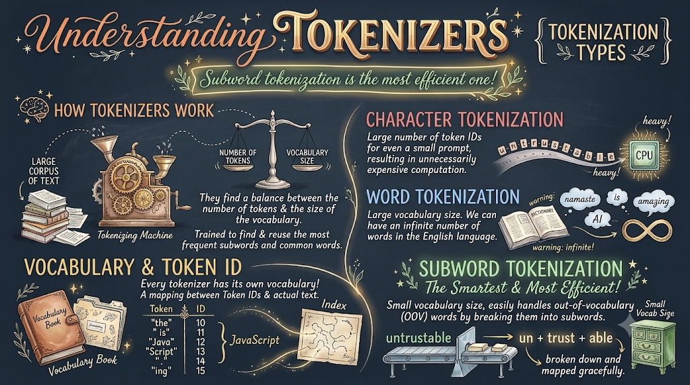
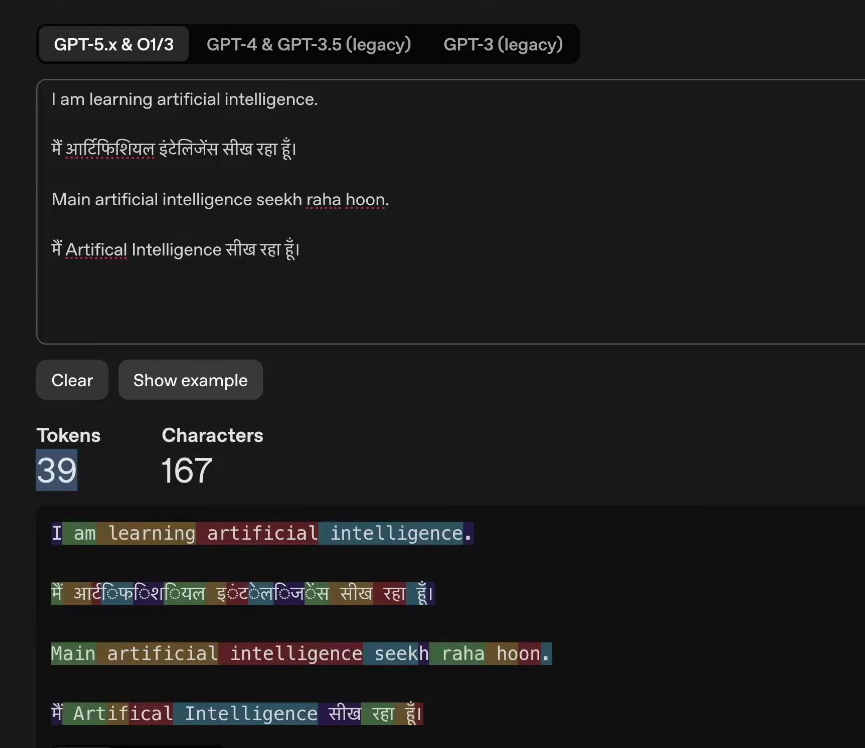

# The secret language of LLMs

_**Q.**_ **When we give a prompt to an LLM, how does it understand what we are asking for, and in which language?**
_Ans._ LLMs only understand numbers. The prompt is not sent as-is. It is converted into tokens, and each token gets a number called a token ID. LLMs see only the sequence of token IDs, and they just predict the next token ID in the sequence.

## What is a token?

A token is a unit of text defined by the tokenizer. A tokenizer is a program that converts text into tokens (`encoding`) and back (`decoding`).

> [!CAUTION]
> Each word is not a token. 1 word != 1 token

Different LLMs use different tokenizers, and each behaves differently. The [Playground](https://platform.openai.com/tokenizer) shows how many tokens a given text produces.

### Why do LLMs use subword tokenization?

Tokenizers are trained on a large corpus of text. They find the most frequent subwords and reuse them as much as possible. This balances the number of tokens against the size of the vocabulary. Of character, word and subword tokenization, subword is the most efficient.

Every tokenizer has its own vocabulary: a list of all the tokens it can recognize, mapping token IDs to text. The whole prompt must be convertible into tokens from that vocabulary. Common techniques to build vocabularies are _Byte Pair Encoding (BPE)_, _WordPiece_ and _Unigram_.

> [!TIP]
> The vocabulary decides how many tokens a text produces. If we write gibberish, it produces far more tokens than meaningful text of the same length, because tokenizers find the most frequent subwords in English. The further we move from English, the more tokens we get.
> Tokens also drive the cost of inference: more tokens need more compute.
> 

**Tokenization fertility** measures how many tokens a given text produces. Higher fertility means more tokens.

Modern LLMs use far fewer tokens than older ones, thanks to better tokenizers and richer vocabularies. Today the vocabulary also covers emojis, special characters and more.

## Context Window

The amount of tokenized text an LLM can process in a single request is the **context window**. No LLM has an infinite one. When a prompt exceeds it, we need a strategy:

- reject the request
- remove older messages
- truncate
- split one request into many
- summarize

Sizes differ by model: some have 1M tokens, others 200k. The window holds everything: user messages, system prompt, tool outputs, assistant messages and more.

> Visible messages in interface `!=` Messages in request to LLM

**One curious question**: If token IDs have no meaning and are just numbers, how does the LLM know which language the prompt is in? How does it know what to respond in? How does it understand the prompt?
