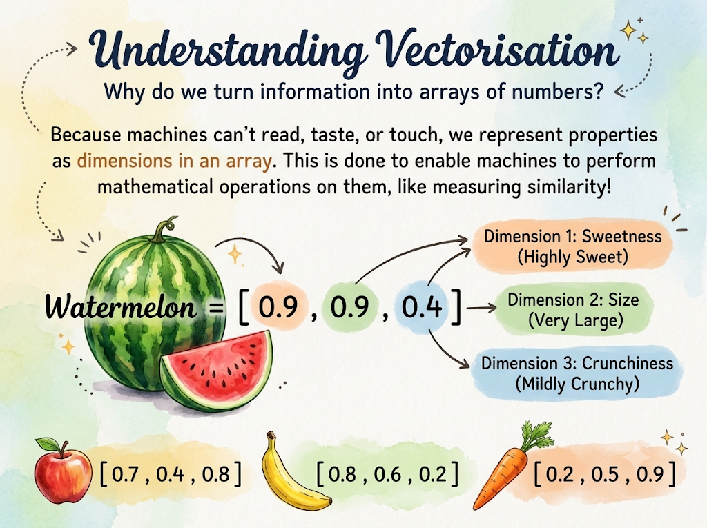
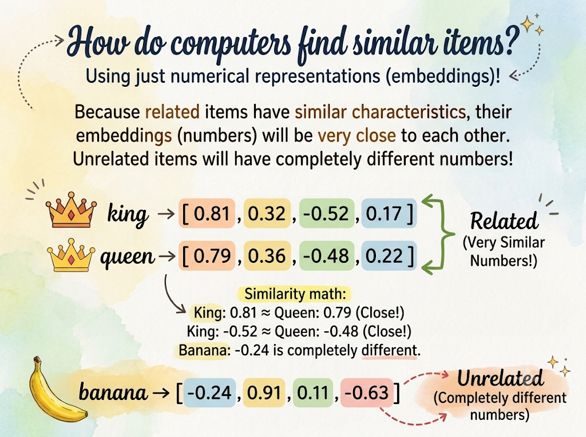
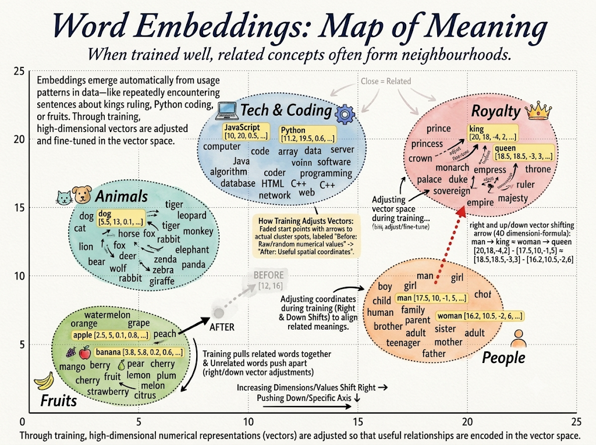
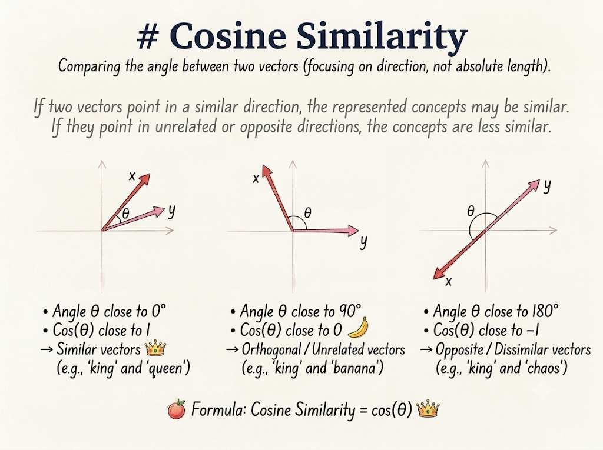

# How machines understand meaning

For example, if I say

```txt
I ate the apple in the afternoon.
```

v/s

```txt
Apple launched a new device
```

How machines can understand which "apple" I am referring to in the given context ? As we know in previous lesson, token IDs don't contain any semantic meaning.

## Vectorisation and Embeddings

It is the process of converting any piece of information (text, images, documents etc.) into numerical vectors (just array of numbers), so that machine can perform mathematical operations on them.



These numbers are called embeddings. They capture the semantic meaning of the information. Embedding models do this vectorisation. Each company has its own embedding models. Modern embedding models use thousands of dimensions. These dimensions are learnt from large datasets. Think about every piece of data on the internet, and how much information it holds. Embedding models are trained on such large datasets. This training lets them learn the semantic meaning of the information.

> [!TIP]
> An embedding is a learned numerical representation of an item that captures useful relationships with other items. It is not the actual meaning of the item, but rather a way to represent it in a form that captures useful patterns and relationships about the item, and machines can work them easily.

These embeddings learn these patterns, not given by humans. For example, if you have a dataset of images of cats and dogs, the embedding model will learn to represent cats and dogs in a way that captures their similarities and differences, without being explicitly told what a cat or dog is.



Numerical representation may also have relationships between "Monkey" and "Banana", "Dog" and "Bone", "Car" and "Road". Because, these relationships are learned from the enormous actual data in the internet.

#### Dimensions in embeddings

> [!CAUTION]
> More embeddings don't always mean better intelligence.

Higher dimensions in embeddings can capture more complex relationships, but they also require more data and computational resources to train effectively. It's important to find a balance between the number of dimensions and the quality of the embeddings. Also, performing mathematical operations on high-dimensional vectors can be computationally expensive. For example, dimensions for a human can be: `height`, `weight`, `age`, `gender`, `hair color`, `eye color`, and so on. Language is far more complex than we think, a word can have multiple meanings in different contexts. That's why embedding models use thousands of dimensions to capture the nuances of language.



> [!TIP]
> You can explore multi-dimensional vectors using [Embedding Projector](https://projector.tensorflow.org/)

#### Semantic similarity

It measures how close two pieces of information are in meaning. For example, "How do I center a div" and "How can I align an HTML element in the middle of its parent container" are semantically similar, even though they use different words. A keyword based system will struggle to find the similarity between these two queries, but an embedding model can capture the semantic meaning and understand that they are related.



$$
\text{similarity}(A, B) = \cos(\theta) = \frac{A \cdot B}{\|A\| \, \|B\|}
$$

At the end of the day, everything is just pure complex mathematical operations on numbers. That's why, embedding systems allow compare broader meaning rather than only matching identical words.

> [!CAUTION]
> Embeddings doesn't not understand truth. It just capture relationships, but not independently verify facts, intent, quality or safety. For example, "Javascript is the best language" and "Javascript is the worst language" are semantically similar, but they have opposite meanings and it doesn't know which one is true. So, emeddings just tell us how similar two pieces of information are, but not whether they are true or false.
